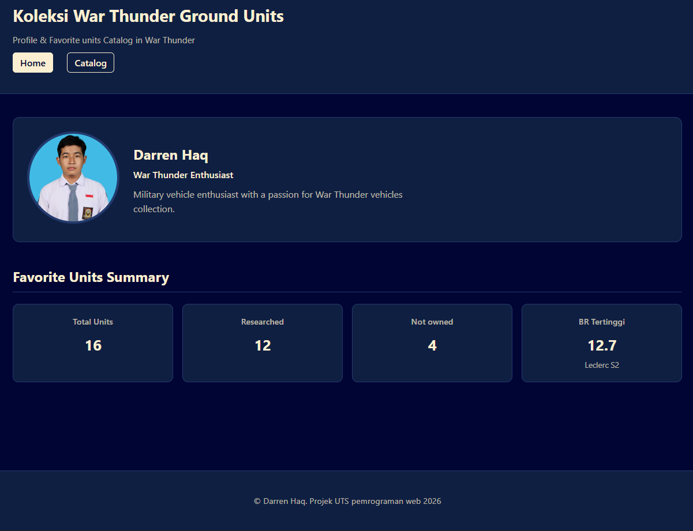
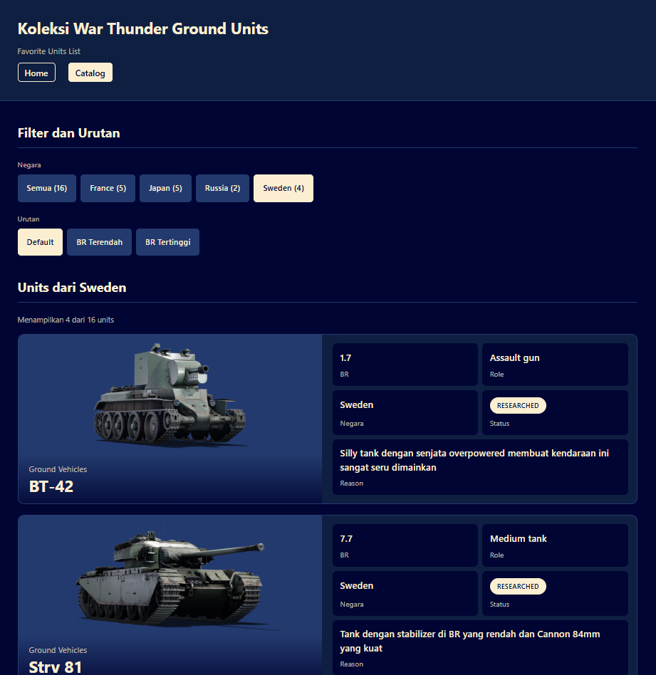

# UTS PemrogWeb

**Nama:** Darren Haq  
**NIM:** 025A00232001  
**Kelas:** A2-3B
**Mata Kuliah:** Pemrograman Web

## Deskripsi
Website profil dan katalog koleksi ground units favorit dari game War Thunder.  
Data disimpan di dalam array PHP multidimensi, dirender secara dinamis dengan perulangan dan percabangan, tanpa database.

## Cara Menjalankan di Localhost
1. Pastikan Laragon sudah berjalan.
2. Letakkan folder proyek di `www`.
3. Buka browser, akses:
   `http://localhost/nama-folder-proyek/`
4. Halaman utama: `index.php`  
   Halaman katalog: `katalog.php`

## Daftar Fitur
- Profil kolektor : ditangani di `index.php`
- Ringkasan koleksi (total unit, researched, not owned, BR tertinggi) : `countByStatus()`, `getHighestBrUnit()` di `index.php`
- Filter unit berdasarkan negara : `getUniqueCountries()`, `filterByCountry()`, `countByCountry()` di `katalog.php`
- Urutkan unit berdasarkan BR : `sortByBattleRating()` di `katalog.php`
- Badge status (Researched / Not Owned) : `getStatusLabel()`, `getStatusClass()` di `katalog.php`
- Escape output HTML : fungsi `e()` dipakai di semua halaman

## Fungsi Array Bawaan yang Dipakai
- `count()` : menghitung total unit dan hasil filter
- `array_filter()` : menyaring unit berdasarkan status atau negara
- `array_column()` : mengambil kolom country / battle_rating
- `array_unique()` : mengambil daftar negara tanpa duplikat
- `array_sum()` : menghitung total BR untuk rata-rata
- `usort()` : mengurutkan unit berdasarkan BR

## Screenshot
  

## Sumber & Catatan
- Referensi: 
    (https://wiki.warthunder.com/unit/jp_type_10)
- Bantuan AI: digunakan untuk merapikan struktur kode dan CSS.